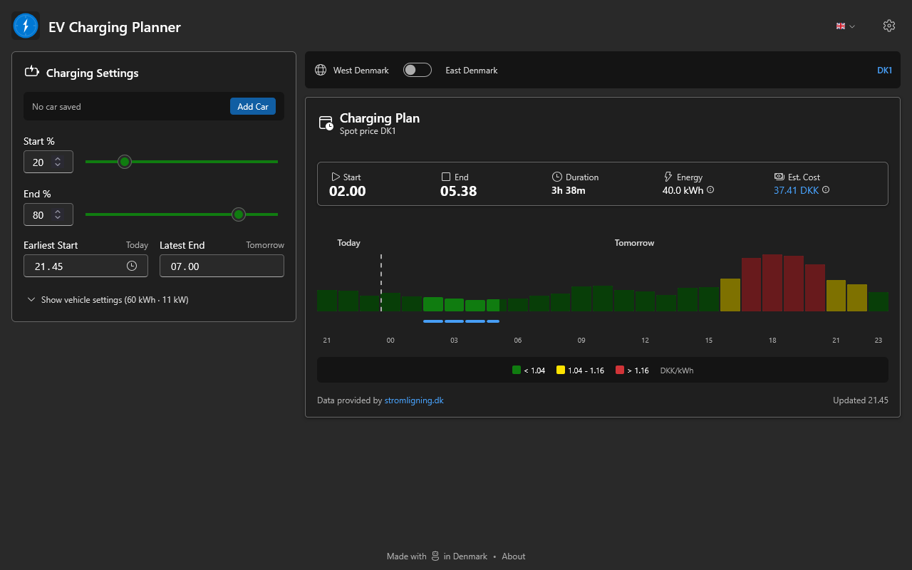
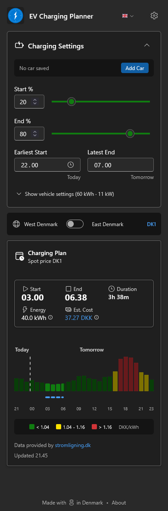

# EV Charging Planner

A React application that helps users find the cheapest time window to charge their electric vehicle based on hourly electricity prices from Danish energy suppliers.





## Features

- Calculate optimal charging windows based on real-time electricity prices
- Save and manage multiple car profiles (battery size, charging speed)
- GPS or postal code lookup for grid operator detection
- Searchable electricity supplier selection
- QR code and sync code sharing for car profiles
- PWA support for offline access

## Tech Stack

- **React 19** with TypeScript
- **Vite** for development and building
- **Fluent UI React** components
- **TanStack Query** for data fetching and caching
- **Vitest** for unit testing
- **Playwright** for E2E testing

## Development

```bash
npm install      # Install dependencies
npm run dev      # Start development server
npm run build    # Build for production (runs tests first)
npm run test     # Run unit tests
npm run test:e2e # Run E2E tests
npm run lint     # Run ESLint
```

## API

Price data is fetched from [stromligning.dk](https://stromligning.dk).

```bash
npm run codegen:api  # Regenerate API types from swagger
```

## Škoda proxy (optional)

The MyŠkoda Public API doesn't allow browser calls (no CORS), so `proxy/` contains a small self-hosted, read-only proxy. It hands out encrypted tokens, each locked to one VIN, and forwards only the vehicle reads the app needs.

```bash
npm run proxy:dev     # Run the proxy locally with reload
npm run proxy:test    # Run the proxy tests (also part of npm run test)
npm run proxy:build   # Bundle to proxy/dist/index.js for deployment
npm run proxy:secret  # Generate a token secrets file
```

See [docs/skoda-proxy-spec.md](docs/skoda-proxy-spec.md) for the design and [docs/skoda-proxy-deployment.md](docs/skoda-proxy-deployment.md) for systemd, Apache, nginx, Caddy and Docker setup.

## License

MIT
